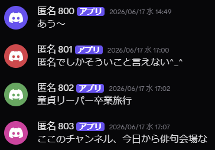

<h1>
  匿名チャットDiscordBot
  
  
  
  
  
</h1>
Discordサーバーに匿名投稿機能を追加するBotです。 
 

 
匿名チャットの様子

 

## なんのためにつくった...?

サーバー新規参入者にとってみんな共通の顔見知りがあるなかで喋るのは難しい...  
匿名チャットはそんな過疎鯖を活性化するために作られました。  
大型鯖で導入する際は匿名の性質上荒れることも考え、匿名経由での処罰機能等も実装しております！！ 

現在、Beta版として7000人越の鯖に仮導入しております。もし導入したい方はご相談を...

## 軽い説明

このBotは、Discordサーバー内に匿名掲示板のような機能を追加するためのBotです。  
投稿者のDiscordアカウントは通常の投稿表示には出ません。投稿ログの保存が有効な場合、Botは投稿とユーザーIDの対応を保存します。DB管理者やBot管理者は保存された情報を確認できるため、完全な匿名性を保証するものではありません。
「匿名つぶやきモード」と「匿名要望モード」の2つの運用形態をサポートしています。  
通報・処罰はBot経由で行い、サーバー管理者向けの操作画面には匿名投稿者のDiscordユーザーIDを表示しません。

## 特徴など...

* **モード:**
  * **匿名チャットモード:** メッセージに「匿名 001」のようなIDが付与される標準的なモードです。
  * **匿名要望モード:** IDが表示されず「匿名」としてのみ表示される、要望や意見募集に適したモードです。
* **画像:** どちらのモードでも専用ボタンから安全に画像を投稿できます。
* **メッセージの編集・削除・返信:** 投稿者本人は投稿したメッセージを後から操作でき、他者の匿名投稿への返信も可能です。
* **通報システム:** ユーザーは不適切なメッセージを簡単に通報できます。一定数の通報が集まると、自動的に管理者に通知されます。

## コマンドリスト

### ユーザー向け (メッセージを右クリック or 長押し > アプリ)

* `メッセージに返信`: 指定した匿名メッセージに対して返信を行います。(>>[数字]の形式で)
* `メッセージを編集`: 自分が投稿した匿名メッセージの内容を編集します。
* `メッセージを削除`: 自分が投稿した匿名メッセージを削除します。
* `匿名つぶやき通報`: 不適切だと思われる匿名メッセージをサーバー管理者に通報します。

### 管理者向け

* `/setup`: 実行したチャンネルを「匿名つぶやきモード」など好きなモードで設置します。
* `/settings`: このチャンネル、またはサーバー標準の設定を変更します。(禁止キーワード・通報先など)
* `/reports`: 通報を確認して、サーバーBAN・1ヶ月タイムアウト・処罰なしを選択します。
* `/stop`: 実行したチャンネルの匿名投稿受付を停止します。
* `/panel`: このチャンネルの案内を現在の設定でもう一度送ります。(誤って消したとき用)

## ライセンス

[GPL-3.0](LICENSE)  

---

© 2026 yexe
# ローカル画像・動画の安全判定

`bun install` 後、`ffmpeg` と `ffprobe` をPATHに配置してください（Dockerイメージには同梱）。Bot起動時に一度だけCPU用の `onnxruntime-node` セッションを作ります。Pythonや画像判定の外部APIは使用しません。モデルがない初回起動ではHugging Faceから自動取得するため通信が必要です。以後の推論はローカルです。

手動配置する場合は、[モデルの固定リビジョン](https://huggingface.co/OwenElliott/image-safety-classifier-xs/tree/54f4560bd9c5ee92d45dc30418a8f8680e80de6d) の `config.json` と `onnx/image-safety-classifier-xs.onnx` をそれぞれ `models/image-safety-xs/config.json` と `models/image-safety-xs/model.onnx` に置いてください。`SAFETY_MODEL_DIR` で配置先を変更できます。コンテナではこのディレクトリを永続化すると再起動時の再取得を避けられます。

このリビジョンには `preprocessor_config.json` がありません。configの `pretrained_cfg.label_names` を読み込み、ラベルを対応付けます。実ONNXを確認した入出力は `image`（float32、バッチ1、RGB CHW、224×224）と `probabilities`（3分類）です。[ONNX版の仕様](https://huggingface.co/OwenElliott/image-safety-classifier-xs) に従い、RGBに変換してbilinearで224×224に伸縮し、0〜255で入力します。グラフ内に255除算、平均・標準偏差による正規化、Softmaxが含まれるため二重適用しません。通常のtimm版のbicubic・中心クロップとは異なります。モデルを置き換える際はこの仕様を再確認してください。

`src/media/safety.ts` の `classifyImage(Buffer | string)` は `{ sfw, nsfw, nsfl, label }` を返します。URL取得には既存の公開HTTPS限定・サイズ制限付きダウンローダーを使用します。JPEG/PNG/GIF/WebPに対応し、単体APIではアニメーションの先頭フレームを判定します。投稿時はアニメーションも約5秒ごとに判定します。

`/setup` と `/settings` の「画像・動画の安全設定」でNSFW（エロ・性的表現）とNSFL（グロ・流血）を個別に許可できます。初期値と旧設定は両方拒否です。実写／二次元や裸／性的行為の細分類はこのモデルの出力にないため区別しません。一般添付、画像URL、X動画リンクを含め送信直前の現在設定で検査します。非画像・非動画ファイルは従来通りです。

動画は先頭と約5秒ごとのフレームを逐次判定します。最大10分、解析タイムアウト120秒、取得上限32MiBです。`FFMPEG_PATH` / `FFPROBE_PATH` で実行ファイルを指定できます。壊れた画像・動画や判定失敗は拒否します。サンプリング間の短い場面やモデルの誤判定は検出できないことがあります。

メモリ優先でsharpキャッシュ無効、sharp並列数1、CPU推論スレッド1、推論同時数1、CPUメモリアリーナ・メモリパターン無効です。モデルロード時と各推論時にRSS（MiB）・所要時間・ラベルをログに出します。低メモリ環境では `MEDIA_CONCURRENCY=1` も設定してください。

検証は `bun run check` と `bun run test`。実画像4分類の確認は、管理者が用意した成人のみの適法なサンプルを `sfw.jpg`、`nsfw-real.jpg`、`nsfw-anime.png`、`nsfl.jpg` として置き、`SAFETY_FIXTURES_DIR` にディレクトリを指定して `bunx tsx --test tests/safety.test.ts` を実行します。未指定の場合、この4件は明示的にスキップされます。サンプルはGitに追加しないでください。
